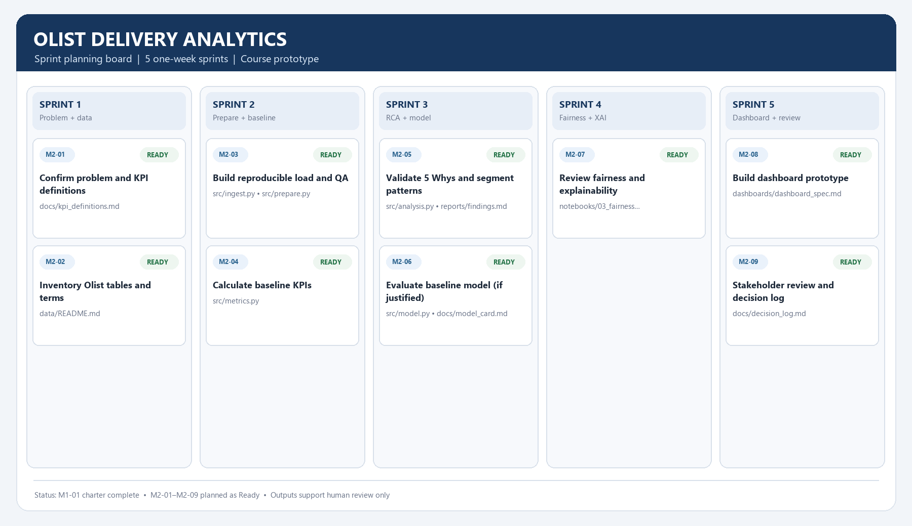

# Olist Delivery Analytics

Course project: investigate late delivery and customer experience using the public Olist Brazilian E-Commerce dataset.

**GitHub project folder:** https://github.com/snnaim-svg/Nexford/tree/main/olist-delivery-analytics

## Getting started
1. Review the charter, data dictionary, KPI definitions, ethics charter, sprint board, and source manifest.
2. Create a Python environment and install `requirements.txt`.
3. Obtain the public dataset from Kaggle; do not commit raw data.
4. Follow the notebooks and Python modules for profiling, preparation, KPIs, analysis, and fairness review.

## Data and privacy
Raw and interim files are excluded from Git. Do not upload credentials or row-level data. Aggregate results and disclose limitations. Outputs support human investigation only.
