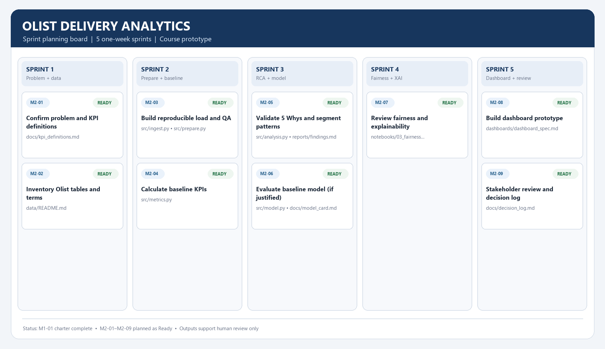

# Sprint board snapshot

This image is the project’s sprint-planning snapshot. Ticket IDs and deliverables match the Module 2 plan and the repository structure. All Module 2 tickets are planned as Ready; the Module 1 charter is complete.

To create the live GitHub Projects board, add a board view grouped by Sprint and use Status, Owner, Priority, and Repository Path fields. The live board is not configured from this session.
