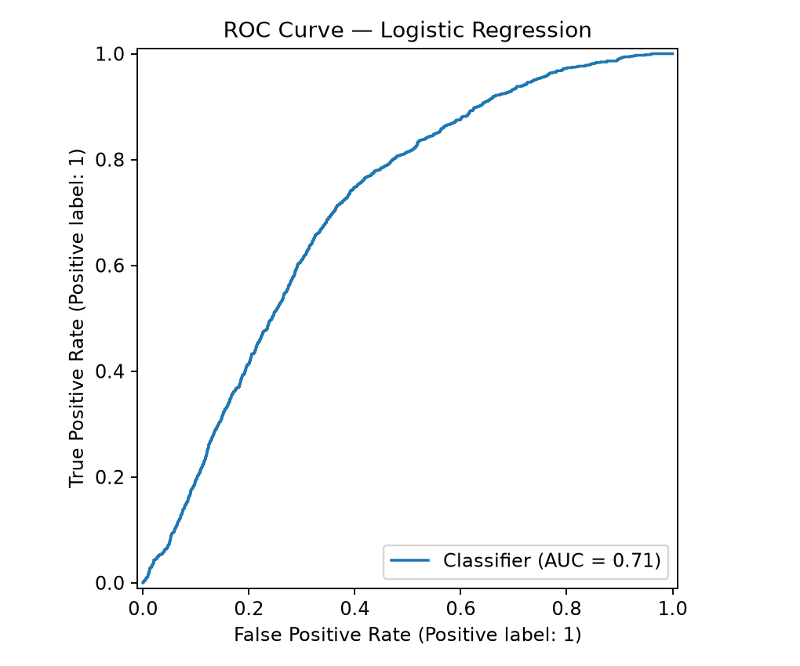
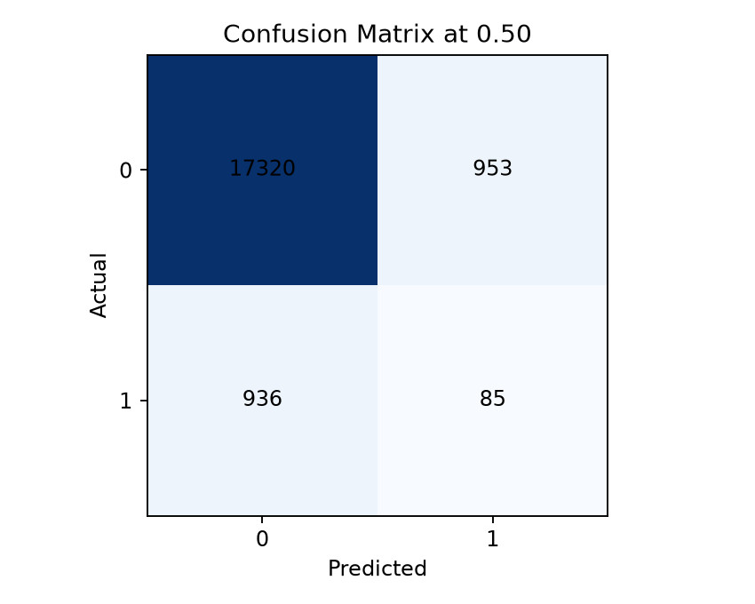
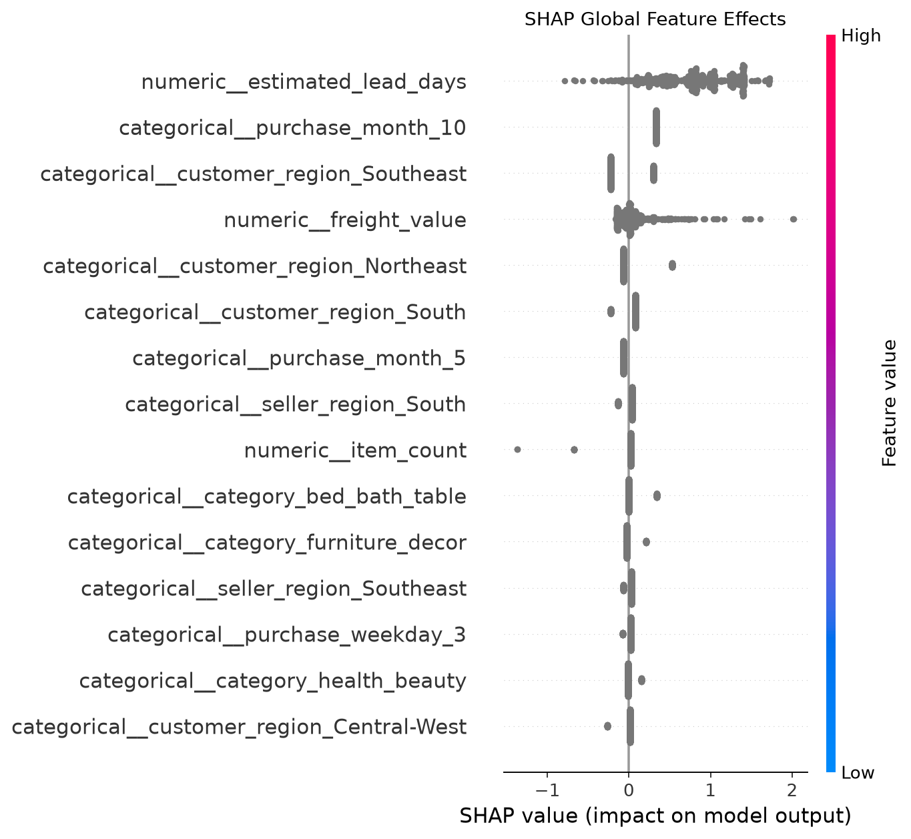
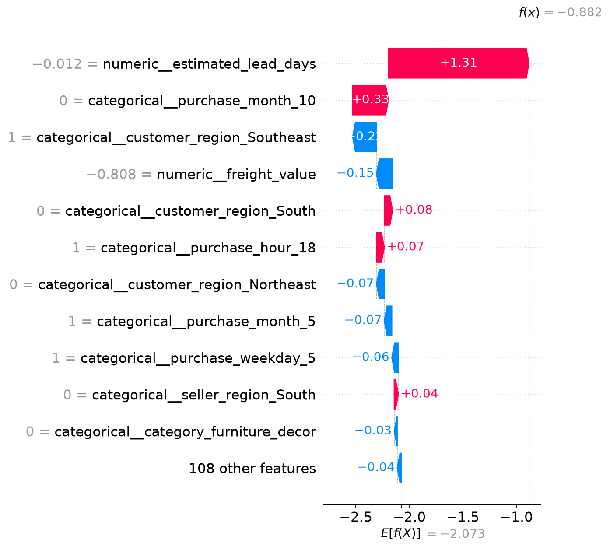

# Olist Delivery Risk Model Validation Report

**Sandra Nassif | BAN6800 | Module 4 | November 25, 2026**

Repository: https://github.com/snnaim-svg/Nexford/tree/codex/module4-olist-explainability/olist-delivery-analytics/module4

## Executive summary

This report evaluates a purchase-time advisory classifier for late-delivery risk in the Olist Brazilian E-Commerce Public Dataset. The model is intended to help logistics analysts identify patterns for service investigation; it is not a customer-facing guarantee, a seller score, or an automated intervention. The final model is Logistic Regression, selected using three-fold stratified cross-validation on the training period. The evaluation uses a later chronological hold-out of 19,294 delivered orders. Its measured test ROC-AUC is 0.707, PR-AUC 0.093, recall 0.083, precision 0.082, and F1 0.083. Results are predictive associations in a historical marketplace sample, not causal evidence. The Olist files contain no age, gender, race, or other protected demographic fields. Regional diagnostics therefore describe service/model variation across Brazilian macroregions and cannot establish demographic fairness. The model remains a course prototype and should not be deployed without new temporal validation, lawful subgroup data, human oversight, and governance approval.

## 1. Business need and target

The Module 1 vision and Module 2 project overview focus on making delivery performance visible so operations teams can investigate late deliveries and improve customer experience. This model addresses that same issue at order level: at checkout, estimate the probability that a delivered order will arrive after its promised date. The task is binary classification, with one order as the unit of analysis. The outcome is 1 when actual delivery is later than the order’s estimated delivery timestamp and 0 otherwise. Because the target becomes observable only after delivery, training is retrospective; the intended prediction moment is checkout, before the outcome occurs. The historical source spans 2016–2018 and therefore cannot establish current carrier or marketplace performance (Olist, 2018). The operational objective is to provide early risk signals for analysts, with recall and ranking quality considered alongside false alarms. No target threshold is declared operationally optimal; 0.50 is used for the comparison table only. The Module 1 fairness commitment to avoid disproportionate impact is carried forward as a requirement for future evaluation, not a claim this dataset can satisfy.

## 2. Data readiness and feature set

The input is the public Olist multi-table CSV snapshot described in the Module 2 Data Dictionary. Tables were joined at order grain using order, customer, product, and seller keys. The eligible modeling population contains 96,470 delivered orders with usable purchase, actual-delivery, and promised-delivery timestamps and item-level basket data. Each row has checkout-time planned lead days, item count, basket value, freight value, translated product category, broad customer and seller regions, and purchase month, weekday, and hour. Identifiers, customer city/postal address, free text, review scores, payment details, and post-purchase information are excluded. Numeric fields are median-imputed and standardized; categoricals are most-frequent imputed and one-hot encoded with unseen values ignored. The output table is built in memory and is not committed. Only aggregate metrics and the trained model artifact are retained.

Data preparation removes duplicate order keys, validates one-to-many joins through aggregation to one order per row, parses timestamps as UTC, and limits labels to delivered orders with complete actual and promised timestamps. An order with a missing delivery event cannot be labeled as on-time; silently treating it that way would introduce label error. Restricting analysis to completed deliveries also creates outcome-observation selection: the model does not estimate risk for canceled, returned, or still-open orders. Basket value and freight are summed across line items, while the modal category and seller region summarize multi-item or multi-seller orders. These compact summaries lose composition detail and may hide a high-risk line item. The data dictionary and code make these choices explicit so a reviewer can reproduce and challenge them.

## 3. Leakage controls and validation protocol

The hold-out is chronological rather than random: the earlier 80% of eligible orders (n=77,176) is used for training and cross-validation; the later 20% (n=19,294) is reserved for final evaluation. This better resembles prediction on later orders than a shuffled split, though it does not make a 2016–2018 sample representative of current conditions. A majority-class DummyClassifier provides the baseline. Logistic Regression and Random Forest are compared. Logistic regularization C is selected from 0.3, 1, and 3 using three-fold stratified CV on training data, scored by average precision; the selected C is 0.3. The Random Forest uses 120 trees, minimum leaf size 12, square-root feature sampling, and balanced subsampling. The predeclared final model is Logistic Regression because it is the model tuned by training-only cross-validation and its coefficients can be inspected; the test set does not select the winner. Leakage checks keep actual delivery time solely in the target expression and prevent order status, review, customer identifiers, and other post-checkout fields entering the predictor matrix. Class imbalance is addressed through balanced class weights for fitted classifiers; metrics include precision-recall performance and per-group error rates rather than accuracy alone.

Every preprocessing step is inside the scikit-learn pipeline, so imputation, scaling, and category encoding are fitted on training folds and then applied unchanged to the hold-out. The time cutoff is between two orders purchased within minutes of each other, avoiding a broad calendar gap but requiring caution: operational conditions can change quickly and a single historical window can produce optimistic or pessimistic results. Random seeds are fixed for repeatability. Tuning is intentionally coarse and limited to one regularization grid; no extensive search was performed that might overfit the validation data. These choices favor a traceable comparison over a claim of globally optimal hyperparameters.

## 4. Performance and validation evidence

The held-out positive rate is 5.3%. Table 1 reports both model candidates and the majority baseline. The selected model has ROC-AUC 0.707 and PR-AUC 0.093; its recall is 0.083, precision 0.082, F1 0.083, and accuracy 0.902. The majority baseline’s recall is 0.000, precision 0.000, F1 0.000, and ROC-AUC 0.500. The Random Forest results are included in Table 1 to show the comparison rather than presenting one model in isolation. ROC-AUC measures ranking across thresholds, while PR-AUC and recall are especially relevant when positive cases are less common. Accuracy can appear high simply because most orders are not late, so it is not treated as sufficient evidence. The confusion matrix in Figure 2 uses the fixed 0.50 cutoff; this cutoff is a reporting convention and must be changed only through a documented cost and capacity review. Figure 1 gives the ROC curve.

The selected model identifies some ranking signal but is not ready for an operational pilot. At the reporting threshold, it detects only 85 late orders in the confusion matrix while missing 936 of 1021 actual late orders; its PR-AUC of 0.093 is only modestly above the test prevalence baseline of 0.053. The majority classifier attains higher accuracy by predicting every order on time, yet it detects no late orders. These outcomes make clear why headline accuracy would mislead. Recall at 0.50 is inadequate for a use case framed as early warning, and precision is also low, so indiscriminate alerting could burden analysts. The next research step is a threshold analysis on a validation set, with operations specifying review capacity and relative costs of missed late orders and false alerts before an acceptable operating point is chosen. We do not claim the current model meets a business success criterion.

The saved metrics JSON contains the exact counts, score definitions, time windows, and model settings for reproducibility.

| Model | Accuracy | Precision | Recall | F1 | ROC-AUC | PR-AUC |
|---|---:|---:|---:|---:|---:|---:|
| Majority baseline | 0.947 | 0.000 | 0.000 | 0.000 | 0.500 | 0.053 |
| Logistic Regression | 0.902 | 0.082 | 0.083 | 0.083 | 0.707 | 0.093 |
| Random Forest | 0.918 | 0.059 | 0.036 | 0.045 | 0.640 | 0.074 |

Table 1. Hold-out performance at threshold 0.50.

Figure 1. ROC curve on the chronological hold-out.

Figure 2. Confusion matrix at threshold 0.50.

## 5. Explainability and sensitivity

Global SHAP values are calculated for a bounded, fixed test sample using LinearExplainer on the selected Logistic Regression pipeline. The summary plot ranks encoded inputs by average absolute contribution to the model’s log-odds; positive values increase the late-delivery score and negative values decrease it. This additive attribution follows the SHAP framework, but it explains the model’s association rather than proving that a feature causes delay (Lundberg & Lee, 2017). The local waterfall plot shows the same decomposition for one held-out order. A prediction should be reviewed with its feature values and reference distribution; a SHAP ranking alone is not an operational reason to alter an order. A sensitivity check changes planned lead time by −3, −1, 0, +1, and +3 days for a fixed 200-row test sample and records mean predicted risk. The counterfactual artifact searches for a lead-time perturbation that crosses the 0.50 boundary for one example. This is a mathematical scenario, not recourse: once an order is placed, its promised lead time is not a customer action, and a model perturbation cannot establish a causal intervention. More broadly, feature attribution and counterfactual explanations answer different questions and should not be treated as interchangeable (Mothilal et al., 2020).

The notebook and saved figures make the explanation repeatable for reviewers. One-hot encoded feature names retain their source meaning, though category and region indicators can fragment an underlying concept across several bars. The global chart should therefore be read together with the unencoded fields and model card. Local explanations can vary across instances, and correlated inputs can share or redistribute attribution. No customer identifier is present in the explanation artifact. The selected example is a test row chosen by position for reproducibility, not a representative customer or a case selected to support the model. The counterfactual example found no threshold-crossing change within the tested 15-day range; that result is reported rather than inventing an alternative outcome. A future analyst should inspect multiple examples, including false negatives and false positives, before considering any operational use.

Figure 3. Global SHAP summary for sampled hold-out orders.

Figure 4. Local SHAP waterfall for one hold-out order.

## 6. Fairness assessment

Protected-class fairness could not be measured because the Olist public files do not provide protected demographic attributes. To expose uneven model behavior without mislabeling it, the Fairness Metrics Report compares customer macroregions as operational slices only. Its regional demographic-parity difference is 0.465, regional disparate-impact ratio is 0.019, and regional equalized-odds gap is 0.633. Demographic parity compares predicted positive rates, while equalized odds compares true-positive and false-positive rates; these metrics encode different normative assumptions and neither alone establishes fairness (Fairlearn, n.d.). Small groups have less stable estimates, and geography can correlate with infrastructure, service coverage, or socioeconomic conditions; a regional gap is therefore a prompt to investigate delivery operations, not evidence of discrimination against a protected group. We do not apply a mitigation algorithm because there is no authorized sensitive-attribute basis for doing so and because arbitrary threshold changes could worsen service quality. Before any real deployment, the project would require an approved data source and oversight review for lawful demographic evaluation, uncertainty intervals and minimum sample sizes, and a documented mitigation decision. Until then, outputs must not drive sanctions, compensation, access, or customer treatment.

## 7. Model card, risks, and monitoring

Intended use is internal analyst prioritization of delivery segments for human investigation. Out-of-scope uses include seller ranking or penalties, customer eligibility or compensation, delivery promises, and fully automated operations. Training labels reflect the historical marketplace period, incomplete order observability, and the dataset’s recording conventions. The model does not include carrier, route, weather, or live capacity data; high predictive association should not be read as a root cause. Risks include temporal drift, measurement changes in promised dates, proxy effects from regional features, class imbalance, unstable small-group estimates, and inappropriate reuse of a student prototype. These risks align with the Module 1 ethical risk register and the NIST lifecycle practice of governing, mapping, measuring, and managing AI risk (NIST, 2023). If a future owner proposes a pilot, acceptance conditions should include a fresh time-based evaluation, recall/precision thresholds agreed with operations, calibration and subgroup error review, an explanation review, privacy review, rollback criteria, and an accountable human decision-maker. Monthly monitoring should track late prevalence, precision/recall on matured orders, calibration, input missingness, category/region mix, and drift; alerts should suspend model use when data or performance moves outside approved bounds. MLflow records the actual run parameters, metrics, artifacts, and model version; MLflow documents run-based tracking and local artifact storage (MLflow, n.d.). Version 1 is registered in Staging for review; this registry stage is not production approval. The API returns a probability and explicitly labels the output advisory. FastAPI request-body validation constrains input types and ranges (FastAPI, n.d.). A Model Card makes the intended use, evaluation, and limitations visible to reviewers (Mitchell et al., 2019).

## References

- Fairlearn. (n.d.). Common fairness metrics. https://fairlearn.org/main/user_guide/assessment/common_fairness_metrics.html
- FastAPI. (n.d.). Request body. https://fastapi.tiangolo.com/tutorial/body/
- MLflow. (n.d.). MLflow Tracking. https://mlflow.org/docs/latest/tracking/
- Mitchell, M., Wu, S., Zaldivar, A., Barnes, P., Vasserman, L., Hutchinson, B., Spitzer, E., Raji, I. D., & Gebru, T. (2019). Model cards for model reporting. Proceedings of the Conference on Fairness, Accountability, and Transparency, 220–229. https://doi.org/10.1145/3287560.3287596
- Mothilal, R. K., Sharma, A., & Tan, C. (2020). Explaining machine learning classifiers through diverse counterfactual explanations. Proceedings of the 2020 Conference on Fairness, Accountability, and Transparency, 607–617. https://doi.org/10.1145/3351095.3372850
- National Institute of Standards and Technology. (2023). Artificial intelligence risk management framework (AI RMF 1.0). https://doi.org/10.6028/NIST.AI.100-1
- Olist. (2018). Brazilian e-commerce public dataset [Data set]. Kaggle. https://www.kaggle.com/datasets/olistbr/brazilian-ecommerce
- Lundberg, S. M., & Lee, S.-I. (2017). A unified approach to interpreting model predictions. Advances in Neural Information Processing Systems, 30. https://proceedings.neurips.cc/paper/2017/hash/8a20a8621978632d76c43dfd28b67767-Abstract.html